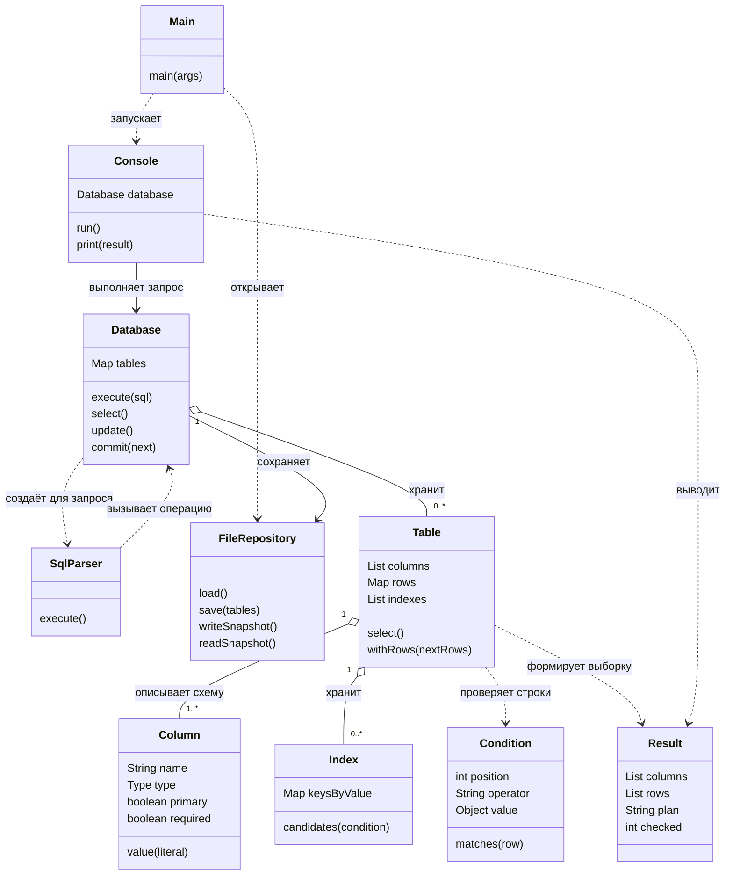
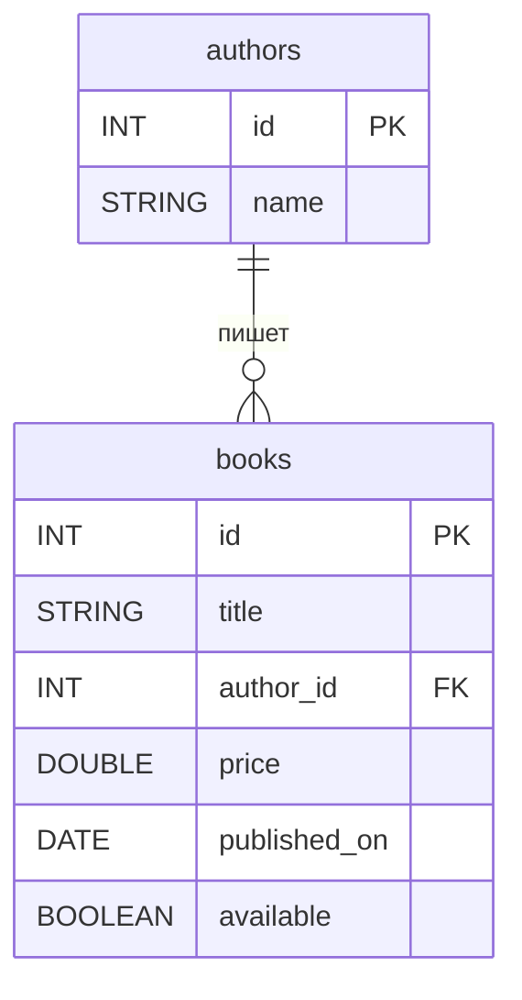
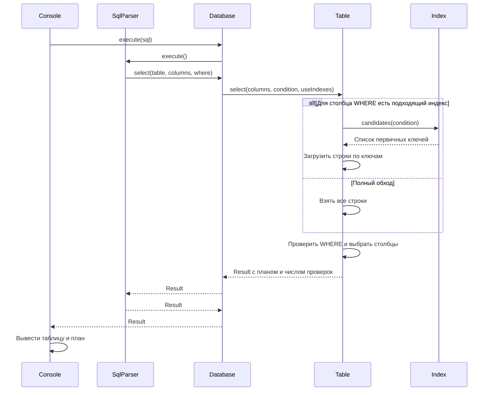
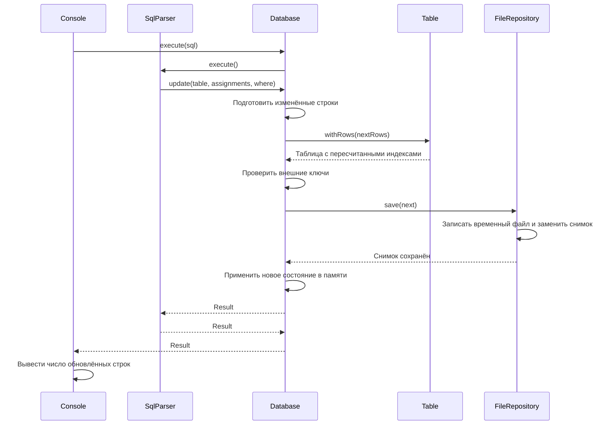

# Лабораторная работа № 2 — СУБД «Библиотека»

Небольшая консольная СУБД на Java 8+ без сторонних зависимостей. На первом
запуске в пустой папке программа создаёт таблицы `authors` и `books` и
добавляет три демонстрационные книги. Последующие запуски загружают
сохранённое состояние той же папки.

## Структура проекта

- `src/` — все Java-файлы. Точка входа — `src/Main.java`.
- `.idea/` и `Library_DB_Java.iml` — настройки IntelliJ IDEA. Папка `src/` отмечена как папка исходников.
- `README.md` — инструкция, SQL-примеры и диаграммы.

При компиляции создаётся `out/` с файлами классов, а при запуске —
`data/` с файлами базы. Их создаёт программа или команда сборки.

## Запуск

Из корня распакованного проекта запустите в PowerShell, CMD, Bash или терминале IntelliJ IDEA.

```text
mkdir out
javac -encoding UTF-8 -sourcepath src -d out src/Main.java
java -cp out Main
```

В IntelliJ IDEA откройте корневую папку проекта. Если IDE предложит
настроить SDK, выберите JDK 8 или новее.
По умолчанию данные хранятся в `data/` относительно рабочей папки процесса.
Путь можно задать вручную.

```text
java -cp out Main demo-data
```

Вводите одну команду в строке. 
`HELP` показывает подсказку, `EXIT` завершает программу. Регистр команд и
имён столбцов свободный. Строковые значения сравниваются с учётом регистра.

## Схема

- `authors` хранит `id INT PRIMARY KEY` и `name STRING NOT NULL`.
- `books` хранит `id INT PRIMARY KEY`, `title STRING NOT NULL`,
  `author_id INT NOT NULL REFERENCES authors(id)`, а также необязательные
  `price DOUBLE`, `published_on DATE` и `available BOOLEAN`.
- Связь 1:N. Автор может быть указан у нескольких книг. Существующая книга
  блокирует удаление её автора и изменение его первичного ключа.
- `DATE` вводится как `'YYYY-MM-DD'`, `BOOLEAN` как `TRUE` или `FALSE`.
  Пустое значение обозначается `NULL`. Пропущенные необязательные столбцы
  при вставке получают `NULL`. В строке апостроф удваивается, например
  `'O''Brien'`.

## Примеры команд

Примеры рассчитаны на первый запуск с начальными данными.

```sql
SELECT * FROM books;
SELECT title, price FROM books WHERE price > 500;
CREATE INDEX idx_books_price ON books (price);
SELECT title, price FROM books WHERE price > 500;

INSERT INTO authors VALUES (4, 'Николай Гоголь');
INSERT INTO books (id, title, author_id) VALUES (4, 'Ревизор', 4);
INSERT INTO books VALUES (5, 'Шинель', 4, 350.0, NULL, TRUE), (6, 'Нос', 4, 300.0, NULL, TRUE);
UPDATE books SET price = 620.0, available = TRUE WHERE id = 4;
DELETE FROM books WHERE id >= 5;

CREATE TABLE shelves (id INT PRIMARY KEY, label STRING);
INSERT INTO shelves VALUES (1, 'Русская классика');
SELECT label FROM shelves;
DROP TABLE shelves;
```

В `WHERE` допускается одно условие с оператором `=`, `!=`, `<>`,
`<`, `<=`, `>`, `>=`, `IS NULL` или `IS NOT NULL`. При сравнении
с участием `NULL` строка отбрасывается. Проверяйте пустое значение через
`IS NULL`. Для `UPDATE` и `DELETE` условие обязательно. Схема
`CREATE TABLE` задаёт один первичный ключ и позволяет объявлять внешние
ключи в описании столбцов. Поддерживается учебное подмножество SQL с
одиночными таблицами и простыми предикатами. Порядок строк в результате
не задан.

## Архитектура

`Main` открывает `FileRepository` и запускает `Console`. Консоль
читает строку и печатает `Result`. `SqlParser` распознаёт имена,
значения и операторы. После проверки конца запроса он вызывает операцию
`Database`. Движок проверяет ограничения и работает с `Table`,
`Column`, `Condition` и `Index`. `Database.createInitialCatalog()` создаёт таблицы и добавляет примеры при первом запуске. Модели таблиц и столбцов независимы
от консоли. Репозиторий выделен как слой файлового хранения.

### Диаграмма классов



`Database` хранит таблицы по имени. В `Table` строки представлены массивами
`Object[]` и доступны по значению первичного ключа. `Column` описывает
тип, обязательность и ограничения столбца. `Result` передаёт в консоль
строки выборки или сообщение о выполнении команды.

### Связь таблиц authors и books



Обе таблицы являются объектами класса `Table`. Например, у книги
«Капитанская дочка» значение `author_id = 1` ссылается на запись Пушкина
в `authors`. Если создать индекс по цене, ключ `550.0` будет вести к
списку, содержащему ID этой книги.

### Диаграмма последовательности SELECT



При наличии подходящего индекса `Table.select()` берёт из него ключи
строк-кандидатов. Затем проверка условия и выбор нужных столбцов
выполняются тем же способом, что и при полном обходе.

### Диаграмма последовательности UPDATE



Диаграмма показывает обновление, которое затрагивает хотя бы одну строку.
Проверки типов, повторов первичного ключа и внешних ссылок проходят до
сохранения. При ошибке консоль выводит сообщение и принимает следующий
запрос, а новое состояние в памяти появляется только после успешной
записи снимка.

### Индекс

Таблица хранит строки по первичному ключу. Индекс хранит словарь
`LinkedHashMap` вида «значение столбца → список первичных ключей».
Для равенства индекс берёт один список через `get()`. Для диапазона
он обычным циклом проверяет каждое различное значение и собирает подходящие
списки. `NULL` хранится отдельным ключом этой же карты. `Table.select()`
получает строки по найденным ID и повторно проверяет `WHERE`. Без
подходящего индекса выполняется полный обход таблицы.

При изменении строк индекс перестраивается из новой версии таблицы.
Снимок сохраняет и сами группы индекса, поэтому при открытии программа
читает их с диска.

### Сериализация и восстановление

`FileRepository.writeSnapshot()` выполняет ручную двоичную сериализацию
через `DataOutputStream`. После заголовка `LDB2` идёт число таблиц.
Для каждой таблицы записываются имя, схема, строки и содержимое индексов.

Перед каждым значением записывается признак наличия. Для `NULL` записывается
только этот признак. Строки хранятся как длина и байты UTF-8, даты — как
число дней от начала эпохи. Индекс сохраняется как группы «значение
столбца → список первичных ключей».

При запуске `readSnapshot()` читает данные в том же порядке через
`DataInputStream` и восстанавливает таблицы, строки и индексы. При чтении
проверяется, что ID в группах индекса соответствуют строкам таблицы.

При изменении данных `FileRepository` сначала полностью записывает
`library.db.tmp` и синхронизирует его с диском. Если основной снимок считается
исправным, его копия сохраняется как `library.db.bak`. Затем
временный файл заменяет `library.db`. Если основной снимок не читается,
программа пробует резервный, в котором может отсутствовать последнее
изменение. `library.lock` защищает папку данных от одновременного открытия
двумя экземплярами программы. Файлы данных, резервные копии, временные
файлы и файл блокировки перечислены в `.gitignore`.

## Демонстрация и результаты замера

Запустите программу с аргументом `demo-data` и вставьте в консоль
команды из блока по порядку. Для первого прогона используйте пустую папку данных.

```text
java -cp out Main demo-data
```

```sql

SELECT * FROM authors;
SELECT * FROM books;
SELECT title, price FROM books WHERE price > 500;
CREATE INDEX idx_books_price ON books (price);
SELECT title, price FROM books WHERE price > 500;
INSERT INTO authors VALUES (4, 'Николай Гоголь');
INSERT INTO books VALUES (4, 'Ревизор', 4, 620.0, NULL, TRUE), (5, 'Мёртвые души', 4, 740.0, NULL, FALSE);
INSERT INTO books (id, title, author_id) VALUES (6, 'Шинель', 4);
UPDATE books SET available = TRUE, published_on = '2024-02-29' WHERE id = 6;
DELETE FROM authors WHERE id = 4;
INSERT INTO books (id, title, author_id) VALUES (6, 'Повтор', 4);
SELECT * FROM books WHERE id = abc;
DELETE FROM books WHERE id >= 5;
SELECT * FROM books WHERE price >= 600;
CREATE TABLE shelves (id INT PRIMARY KEY, label STRING);
INSERT INTO shelves VALUES (1, 'Русская классика');
SELECT * FROM shelves;
DROP TABLE shelves;
EXIT;
```

При первом `SELECT` по цене ожидаются две строки и три проверки. После
`CREATE INDEX` та же выборка возвращает две строки за две проверки.

Три команды в середине намеренно показывают ошибки внешнего ключа,
повторного первичного ключа и неверного типа. После `EXIT;` снова
запустите `java -cp out Main demo-data` и выполните запрос.

```sql
SELECT title, price FROM books WHERE price >= 600;
```

Ожидаются две строки и план `INDEX idx_books_price`. Индекс уже был
записан в снимок вместе с таблицами, поэтому создавать его повторно не нужно.

### Результаты выполненного замера

В замере выполнялся один запрос
`SELECT id, title FROM bench_books WHERE price = 455.0` на 100 000
синтетических строках с 100 совпадениями. Оба режима используют
одну таблицу. Сначала каждый режим выполняет 250 прогревочных запросов,
затем по 250 запросов в каждом из 9 раундов с чередованием порядка.
Сравнивается медиана среднего времени на запрос по раундам. Замер
охватывает разбор SQL, поиск и построение результата в памяти.

| План | Проверено строк | Совпадений | Время на запрос |
| --- | ---: | ---: | ---: |
| Полный обход | 100 000 | 100 | 1026,15 мкс |
| Индекс по цене | 100 | 100 | 12,32 мкс |

В этом запуске число проверенных строк уменьшилось в 1000 раз, а время
запроса — примерно в 83 раза. `Проверено` показывает число
строк-кандидатов, просмотренных после выбора плана.


Javadoc из исходников можно собрать командой
`javadoc -private -encoding UTF-8 -docencoding UTF-8 -charset UTF-8 -d out/javadoc src/*.java`.

## Выводы

Реализованы SQL-операции над связанным каталогом и сохранение каталога
между запусками. На выборке из 100 строк по цене индекс существенно
сократил число проверок.

## Список использованных источников

1. [Oracle Java SE 8 — LinkedHashMap](https://docs.oracle.com/javase/8/docs/api/java/util/LinkedHashMap.html)
2. [Oracle Java SE 8 — LocalDate](https://docs.oracle.com/javase/8/docs/api/java/time/LocalDate.html)
3. [Oracle Java SE 8 — Files](https://docs.oracle.com/javase/8/docs/api/java/nio/file/Files.html)
4. [Oracle Java SE 8 — DataOutputStream](https://docs.oracle.com/javase/8/docs/api/java/io/DataOutputStream.html)
5. [Oracle Java SE 8 — FileDescriptor](https://docs.oracle.com/javase/8/docs/api/java/io/FileDescriptor.html)
6. [Oracle Java SE 8 — DataInputStream](https://docs.oracle.com/javase/8/docs/api/java/io/DataInputStream.html)
7. [GitHub Docs — диаграммы Mermaid в Markdown](https://docs.github.com/en/get-started/writing-on-github/working-with-advanced-formatting/creating-diagrams)
